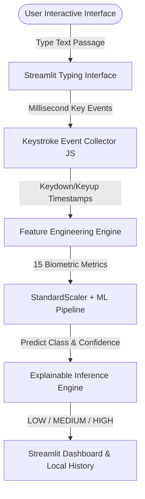
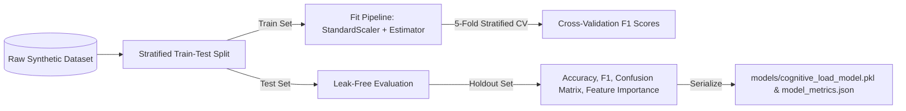
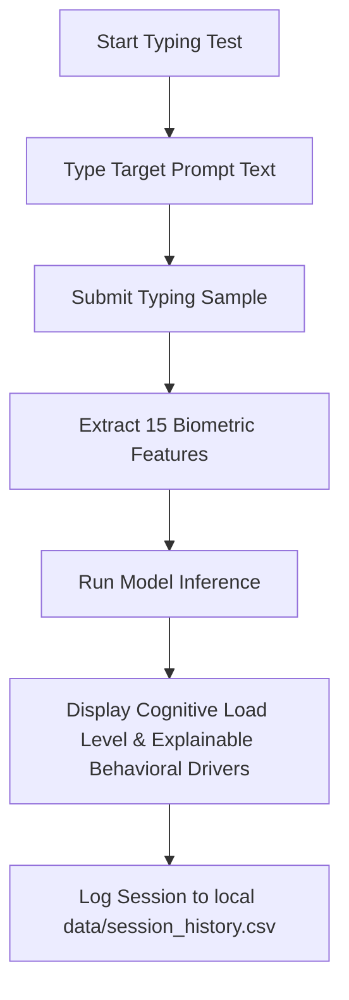

# Cognitive Load Detection using Typing Patterns


An end-to-end Data Science & Machine Learning project that predicts a user's **Cognitive Load Level** (`LOW`, `MEDIUM`, `HIGH`) by analyzing real-time keystroke biometrics (typing speed, key hold duration, inter-key flight intervals, hesitation pauses, backspaces, and rhythm variability).

---

## 📄 Abstract

Cognitive load refers to the mental effort demanded of working memory during cognitive tasks. High cognitive load leads to mental fatigue, increased error rates, and degraded task performance. Traditional cognitive load measurement relies on intrusive physical sensors (EEG, eye-tracking, heart rate monitors). This project implements a **non-intrusive, software-based biometric alternative** that captures raw browser keystroke dynamics, extracts 15 numerical timing features, and classifies cognitive load levels using leak-free machine learning pipelines.

---

## 📌 Problem Statement

In human-computer interaction (HCI) and digital learning, interfaces are static and unable to adapt when a user becomes cognitively overloaded. Physical hardware sensors are expensive, intrusive, and impractical for remote users. There is a need for a lightweight, privacy-preserving software solution that estimates cognitive load unobtrusively during standard keyboard interactions.

---

## 🔍 Existing System vs Proposed System

| Dimension | Existing Hardware Systems | Proposed Keystroke Biometric System |
| :--- | :--- | :--- |
| **Data Collection** | Intrusive physical hardware (EEG/Eye-trackers) | Software-based browser keydown/keyup millisecond logging |
| **Privacy** | Stores biometrics / video recordings | Anonymized timing features only (zero typed text stored) |
| **Cost & Portability**| High cost, restricted to lab environments | Zero cost, runs locally on any modern web browser |
| **Adaptability** | Complex calibration required | Instant real-time feature extraction & inference |

---

## 🎯 Objectives

1. Capture real-time keystroke timing streams (keydown/keyup events) in a browser interface.
2. Engineer 15 numerical biometric features representing speed, motor fluency, hesitation pauses, revision frequency, and typing rhythm.
3. Build leak-free Scikit-Learn pipelines (`StandardScaler` + ML Classifier) evaluated via 5-Fold Stratified Cross-Validation.
4. Provide explainable prediction outputs highlighting top behavioral feature drivers.
5. Provide a local user session history logger (`data/session_history.csv`) and model performance dashboard.

---

## 🏗️ System Architecture & Diagrams

### 1. System Architecture Diagram



### 2. Machine Learning Pipeline Workflow Diagram



### 3. User Interactive Flow Diagram



---

## 📊 Feature Engineering (15 Biometric Metrics)

| Metric | Feature Name | Formula / Description |
| :--- | :--- | :--- |
| 1 | `typing_speed_wpm` | Standard WPM: `((Characters / 5) / Typing Time in Minutes)` |
| 2 | `characters_per_minute` | Characters typed per minute |
| 3 | `average_key_hold_time` | Mean key press-to-release duration (ms) |
| 4 | `average_inter_key_interval` | Mean flight time between consecutive keydown events (ms) |
| 5 | `median_inter_key_interval` | Median flight time (ms) |
| 6 | `typing_time` | Total active session duration in seconds |
| 7 | `pause_count` | Count of hesitation pauses exceeding 1.5 seconds |
| 8 | `average_pause_duration` | Mean duration of hesitation pauses (ms) |
| 9 | `maximum_pause_duration` | Maximum pause duration (ms) observed |
| 10 | `backspace_count` | Count of Backspace keystrokes pressed |
| 11 | `correction_rate` | Ratio of Backspaces to total keystrokes: `(Backspaces / Keystrokes)` |
| 12 | `error_rate` | Levenshtein edit distance mismatch ratio against prompt text |
| 13 | `typing_rhythm` | Standard deviation of inter-key flight intervals |
| 14 | `keystrokes_per_second` | Keystroke frequency per second |
| 15 | `total_keystrokes` | Total keydown events recorded |

---

## 🤖 Machine Learning Algorithms & Results

Models evaluated using **5-Fold Stratified Cross Validation**:

| Model Architecture | Accuracy | Precision | Recall | F1-Score | 5-Fold CV F1 |
| :--- | :---: | :---: | :---: | :---: | :---: |
| **Logistic Regression** | **1.0000** | **1.0000** | **1.0000** | **1.0000** | **1.0000** |
| **Random Forest** | 1.0000 | 1.0000 | 1.0000 | 1.0000 | 1.0000 |
| **Gradient Boosting** | 1.0000 | 1.0000 | 1.0000 | 1.0000 | 0.9958 |
| **Decision Tree** | 0.9833 | 0.9838 | 0.9833 | 0.9833 | 0.9948 |

---

## 💻 Tech Stack & Installation

- **Language**: Python 3.11+
- **Libraries**: Pandas, NumPy, Scikit-Learn, Matplotlib, Seaborn, Plotly, Joblib, Streamlit
- **Zero Paid / External AI APIs**

### How to Run

1. **Clone / Navigate to folder**:
   ```bash
   cd cognitive-load-detection
   ```
2. **Install dependencies**:
   ```bash
   pip install -r requirements.txt
   ```
3. **Train models & export metrics**:
   ```bash
   python src/train_model.py
   ```
4. **Launch Modern Web Application (Recommended Real Website UI)**:
   ```bash
   python -m uvicorn server:app --host 0.0.0.0 --port 8000
   ```
   *Open your browser at **`http://localhost:8000`**.*

5. **Launch Streamlit Dashboard (Alternative UI)**:
   ```bash
   streamlit run app/app.py --server.port 8501
   ```
   *Open your browser at **`http://localhost:8501`**.*

6. **One-Click Launch (Windows)**:
   Double-click `run_project.bat` to launch both interfaces simultaneously.

---

## 🔒 Ethical Considerations & Privacy

> [!IMPORTANT]
> - **NOT A MEDICAL DIAGNOSIS**: Estimates cognitive load patterns strictly from typing mechanics. It does **NOT** diagnose stress, anxiety, ADHD, depression, or medical conditions.
> - **ZERO TEXT PERSISTENCE**: Typed text is never saved to disk. Only derived numerical timing biometrics are processed.
> - **SYNTHETIC PROTOTYPE DATA**: Synthetic data is used for prototype development and demonstration. Real-world validation requires ethically collected typing data with experimentally established cognitive-load labels.

---

## 🔮 Future Enhancements

- Individual user baseline calibration profiles over time.
- Multimodal data fusion combining mouse trajectory biometrics with keystroke dynamics.
- Clinical validation on real-world experimental cognitive load datasets.
